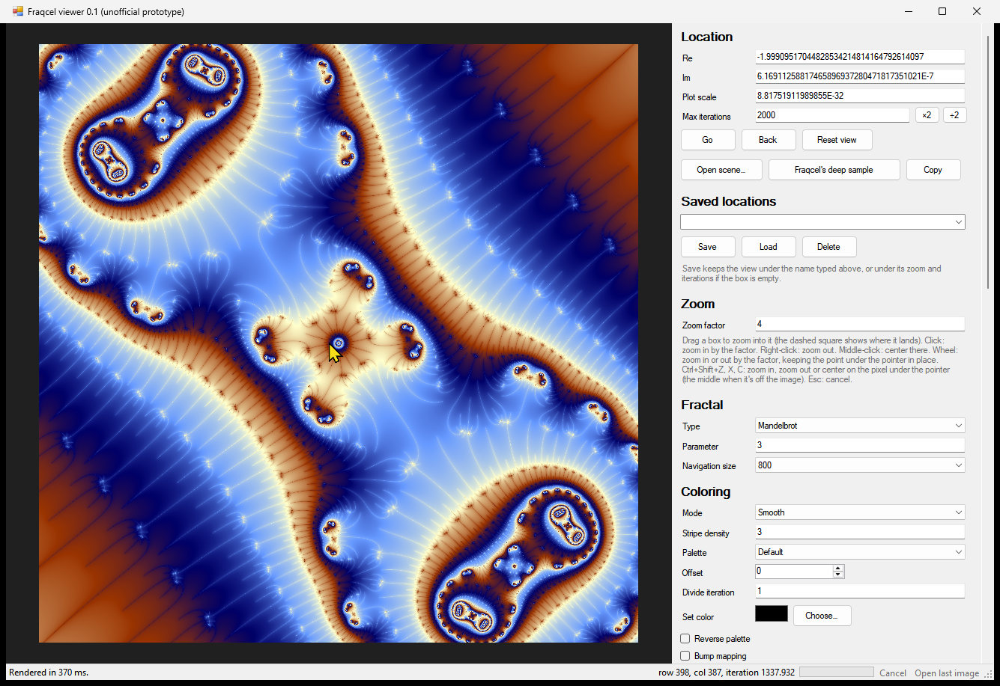
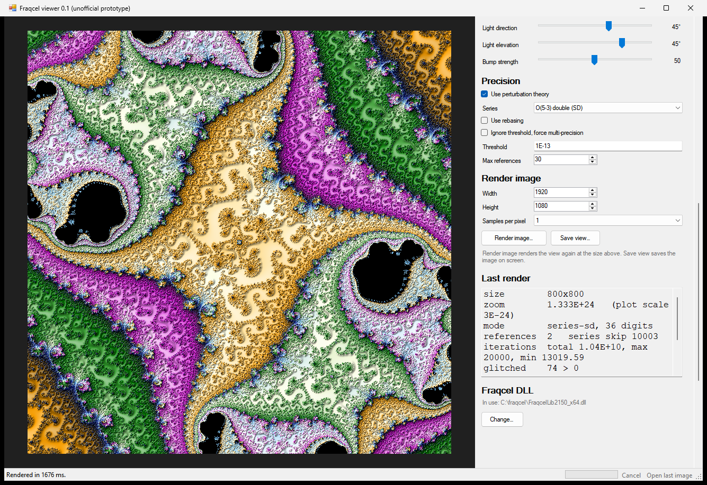

# Fraqcel viewer

An unofficial Windows viewer for [Fraqcel](https://fraqcel.weebly.com/), the deep-zoom fractal generator for Microsoft Excel. It runs Fraqcel's own DLL, unmodified, so you can explore Fraqcel's fractals and render images without Excel.

It is not made or endorsed by Fraqcel's author. Fraqcel itself, with its user guide, is at [fraqcel.weebly.com](https://fraqcel.weebly.com/).

## Getting started

1. Download `fraqcel-viewer-0.1.zip` from [Releases](https://github.com/WindySnowOwl/fraqcel-viewer/releases) and unzip it anywhere.
2. Download Fraqcel 2.15.0 from [its download page](https://fraqcel.weebly.com/download.html). The viewer needs the DLLs in the `optional DLL files\fraqcel` folder of `fraqcel_2.15.0.zip`. Fraqcel's own instructions copy that folder to `C:\fraqcel`; the viewer looks there first, but any folder works.
3. Run `FraqcelViewer.exe`. The first time, it asks for Fraqcel's folder, checks that the DLL is the released 2.15.0 file, and remembers the choice.

It needs 64-bit Windows 10 or 11 with .NET Framework 4.8, which Windows includes. The program isn't signed, so Windows may warn that it comes from an unknown publisher.

## What it does

- Fraqcel's seven fractal types, with its own precision choices: double, multi-precision, and perturbation with both series types and rebasing, including its glitch correction.
- Fraqcel's four coloring modes and six palette presets, with the set color, palette offset, divide iteration, and bump mapping with light direction, elevation and strength.
- Zoom by dragging a box, by clicking, or with the mouse wheel. Double or halve the max iterations, go back, save and load named locations, and open locations saved as `.kfr` files (the format Kalles Fraktaler uses).
- The footer shows the iteration value of the pixel under the mouse, and the panel shows the last render's statistics.
- Renders an image at any size Fraqcel allows, with supersampling, to PNG.
- Remembers its settings and the last view between runs.
- `fraqcel-cli.exe` renders from the command line; `fraqcel-cli --help` lists its options. It looks for the DLL next to itself, or takes `--dll PATH`.

## Limits

- Coordinates use the DLL's EDecimal type instead of Fraqcel's XNUMBERS, so the last digit of a coordinate can differ from Fraqcel's, which may change a few pixels.
- Not yet: Fraqcel's 50% and 33% resolutions, quick pan, refresh, range recalculation, the palette editor, video, and data file import and export.
- 64-bit only. Cancel takes effect between glitch-correction passes, not in the middle of one.

## Building from source

See [README-dev.md](README-dev.md).

## License

The viewer's own code is under the Zero-Clause BSD license ([LICENSE](LICENSE)). The parts ported from Fraqcel's VBA keep Fraqcel's BSD-2-Clause license; [NOTICES.md](NOTICES.md) lists them. Fraqcel's DLL is not included.
